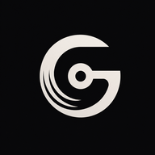
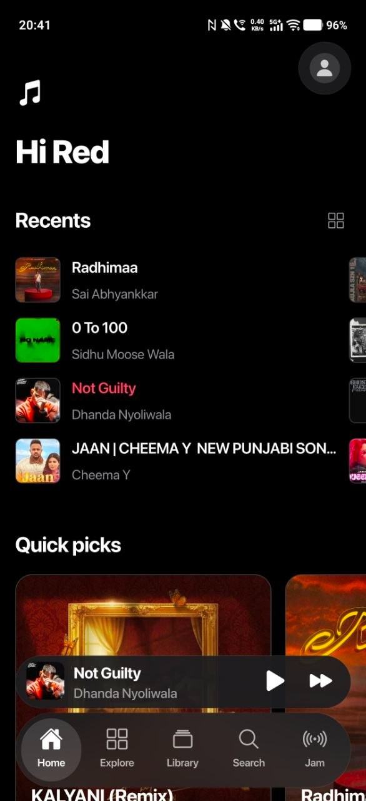
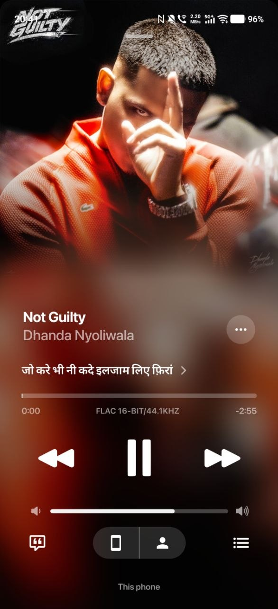
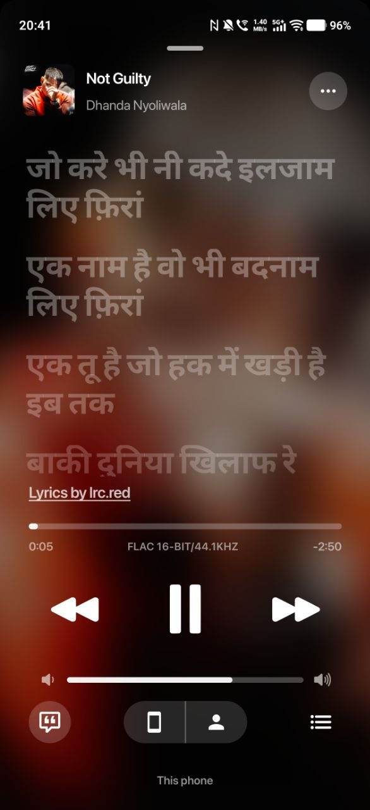
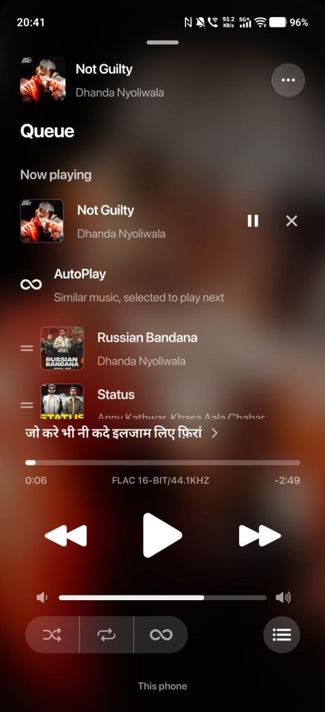

<div align="center">



# Groovix

### Free Music Player & Streaming App for Android

**Hi-Res lossless FLAC, synced lyrics, endless AutoPlay and Listen Together — a fast, ad-free music app built with React Native.**

[](https://github.com/Swotboysandy/groovix_release/releases)
[](https://github.com/Swotboysandy/groovix_release/releases/latest)
[](#-sound-quality)
[](https://reactnative.dev)
[](LICENSE)

**[⬇️ Download the APK](https://github.com/Swotboysandy/groovix_release/releases/latest)** &nbsp;·&nbsp; [Website](https://groovix.pracandy.com) &nbsp;·&nbsp; [Privacy](https://groovix.pracandy.com/privacy) &nbsp;·&nbsp; [Terms](https://groovix.pracandy.com/terms)

<br>

<table>
  <tr>
    <td align="center"></td>
    <td align="center"></td>
    <td align="center"></td>
    <td align="center"></td>
  </tr>
  <tr>
    <td align="center"><b>Home</b><br><sub>Quick picks & your recents</sub></td>
    <td align="center"><b>Now playing</b><br><sub>Full-screen art, lossless FLAC</sub></td>
    <td align="center"><b>Synced lyrics</b><br><sub>Line by line, tap to seek</sub></td>
    <td align="center"><b>AutoPlay queue</b><br><sub>Related songs, never ending</sub></td>
  </tr>
</table>

</div>

---

> [!TIP]
> **Sign in with Google (your Gmail account) for the best experience.**
> - **Instant access** — signing in approves your phone straight away, no waiting.
> - **Your YouTube music on Home** — your YouTube likes, playlists and subscriptions show up as their own shelves.
>
> Open Groovix, tap **Sign in with Google** on the first screen (or later in **Settings**), and choose your account.

> [!IMPORTANT]
> **Free access for life:** after installing, send me a quick DM on Instagram **[@suedoo.tech](https://www.instagram.com/suedoo.tech/)** to let me know. I'll open the music for you, free for life.

## ✨ Highlights

| Feature | What you get |
|---|---|
| 🎧 **Lossless sound** | Up to **24-bit / 192 kHz FLAC**, with the real format shown on the player. |
| 🏠 **Home that loads in seconds** | Quick picks, trending, new albums and music videos from YouTube Music, shown instantly from the last visit while fresh shelves load. |
| ♾️ **Music that never stops** | AutoPlay keeps adding related songs as you listen; a song that can't play is skipped and the queue refills itself. |
| 📝 **Synced lyrics** | Line-by-line and word-by-word lyrics, translation into 20 languages, tap any line to jump there. |
| 👥 **Listen Together** | Share a code; everyone hears what the host plays, pauses or skips to. |
| 🔐 **Google sign-in** | Instant access plus your YouTube likes, playlists and subscriptions. |

## 🎵 Sound quality

Four quality levels, set separately for **Wi-Fi and mobile data**:

| Quality | Format |
|---|---|
| Hi-Res | 24-bit FLAC, up to 192 kHz |
| CD Lossless | 16-bit / 44.1 kHz FLAC |
| High | 320 kbps AAC |
| Data saver | 96 kbps AAC |

- **Hi-Res lossless FLAC streaming** — the highest quality available for each song, with automatic fallback when a track isn't offered in Hi-Res.
- **Live format label** — the player shows what is actually playing (24-bit FLAC, FLAC, AAC), and *Stats for nerds* shows the bit depth and sample rate.
- **Built-in equalizer** — Dynamic tone pad or a 7-band manual EQ, plus left/right balance.
- **Configurable sources** — pick which audio sources are used and in what order.
- **Offline downloads** with their own quality setting and a Wi-Fi-only option.
- **Background playback** with lock-screen and notification controls.

## 🔎 Discovery

- **Home feed from YouTube Music** — Quick picks, Albums & singles, Trending, New music videos and more, painted the moment they arrive.
- **Endless AutoPlay radio** — YouTube Music's own station for the song you're playing, topped up as you go so the queue never runs dry.
- **Explore moods & genres** — Chill, Workout, Focus, Romance and dozens of curated playlists.
- **Search suggestions as you type**, with filters for songs, albums, artists and playlists.

## 📝 Lyrics

- Line-by-line and **word-by-word synced lyrics** from many lyric providers, raced in parallel so the best match wins.
- **Lyrics translation** into 20 languages, shown under each line.
- Tap any line to jump to that moment in the song.

## 👥 Social & personal

- **Listen Together** — share a code or link and play the same music, in sync, with friends. Everyone can add songs and vote.
- **Replay** — your top songs, artists and albums by week, month, year or all time.
- **Google sign-in** to import YouTube playlists, liked videos and subscriptions.
- **ListenBrainz scrobbling** to keep a public record of what you play.
- **Backup & restore** — export all settings and history to one JSON file.

## 🎨 Design

- A clean, modern interface with a glass tab bar, full-bleed artwork and smooth, spring-based animations.
- Light, dark or system theme, haptic feedback, and options to reduce motion and blur.

## ⬇️ Download

Grab the latest APK from the **[Releases page](https://github.com/Swotboysandy/groovix_release/releases/latest)** and install it on any Android phone (Android 7.0+). Groovix updates itself in-app and sends a notification when a new version is out.

1. Download `Groovix-vX.Y.Z.apk` from the latest release.
2. Open it and allow installing from your browser if Android asks.
3. Open Groovix and **sign in with Google** for instant access — or DM [@suedoo.tech](https://www.instagram.com/suedoo.tech/) on Instagram.

## 🛠️ Build from source

**Requirements:** Node.js 20+, JDK 17, Android SDK (NDK 27.1), an Android device or emulator.

Copy `src/config/private.example.ts` to `src/config/private.ts` before building. Left empty, the app runs without the optional proxy, invite gate and Listen Together backend; fill it in with your own servers to enable them.

```bash
git clone https://github.com/Swotboysandy/groovix.git
cd groovix
npm install          # also applies patches via patch-package
npm start            # Metro bundler
npm run android      # build and install the debug app
```

Release APK:

```bash
cd android && ./gradlew assembleRelease
```

## 🧱 Tech stack

| Area | Technology |
|---|---|
| App | React Native 0.84, TypeScript |
| Navigation | React Navigation (bottom tabs + native stacks) |
| Animation | Reanimated, Gesture Handler |
| Playback | react-native-video (ExoPlayer / Media3) with a native audio processor for the equalizer |
| Native modules | Kotlin — equalizer, haptics, APK updater |
| Sign-in | Google Sign-In + YouTube Data API v3 (read-only) |

## 🔒 Privacy

Groovix stores your preferences, history and downloads **only on your device**. Google sign-in is optional and uses read-only YouTube access to show your own playlists and likes. Read the full [privacy policy](https://groovix.pracandy.com/privacy).

## 🤝 Contributing

**Contributions and bug reports are open to everyone.**

- **Found a bug?** [Open an issue](https://github.com/Swotboysandy/groovix/issues/new) with the steps to reproduce it, your phone model, Android version and Groovix version.
- **Have a fix or a feature?** Fork the repo, make your change on a branch and open a pull request. I review every pull request and merge the ones that fit.
- For larger changes, open an issue first so we can talk about the approach.

## 📄 License

Groovix is free software released under the [GNU General Public License v3.0](LICENSE). You can use, study, share and change it; anything you distribute that's based on it must stay open source under the same license.

## ⚠️ Disclaimer

Groovix is a player client. Music, artwork and lyrics belong to their respective owners and are provided by third-party services. Use the app in line with the laws and terms that apply to you.

---

<div align="center">


**Groovix** — free music streaming, synced lyrics and Listen Together for Android.

<sub>Keywords: free music app android, music player, music streaming app, synced lyrics app, lossless music player, FLAC music player, hi-res audio streaming, 24-bit FLAC, FLAC streaming app, lossless audio android, hi-res music player android, high quality music streaming, 192 kHz audio, CD quality music, 320 kbps music app, audiophile music player, youtube music player, listen together, react native music player, ad-free music app, open source music player</sub>

</div>
